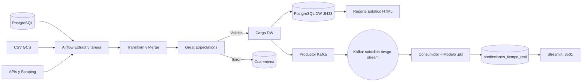
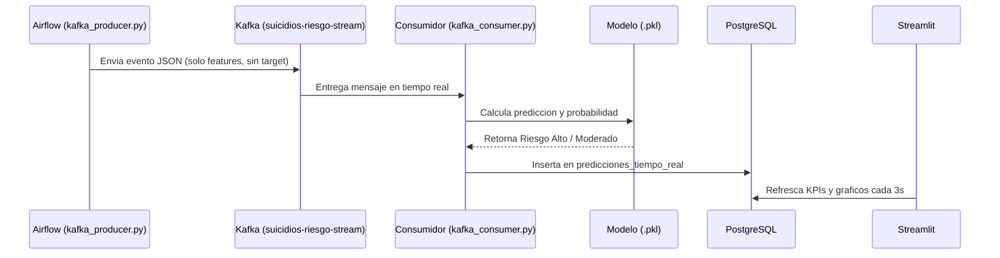

# Monitoreo de Presuntos Suicidios en Colombia (ODS 3) — Proyecto Final ETL

Proyecto final de la materia **ETL (G51)** del programa de Ingeniería de Datos e Inteligencia Artificial, Universidad Autónoma de Occidente.

Este repositorio recoge la evolución completa del proyecto: análisis inicial de presuntos suicidios en Colombia (2015–2024), automatización con Apache Airflow y Great Expectations, y la integración final de un modelo de Machine Learning con streaming en Apache Kafka y Streamlit.

## 1. ¿Qué problema resuelve este proyecto?

Analizar los casos solo con conteos absolutos deja oculta la incidencia real en municipios intermedios y no permite reaccionar a tiempo. Por eso implementamos una arquitectura con dos salidas complementarias:

1. **Análisis histórico (proceso analítico):** Cruzamos los casos con desempleo nacional, festivos y datos territoriales del Valle del Cauca para generar un reporte estático en Python con tendencias y tasas por 100.000 habitantes.
2. **Alerta temprana (proceso operacional):** Enviamos registros validados a Apache Kafka para que un modelo de Machine Learning serializado prediga en vivo si un municipio presenta riesgo alto, mostrándolo en un dashboard de Streamlit.

## 2. Arquitectura general del sistema



## 3. Fuentes de datos utilizadas

| Fuente | Tipo | Aporte al proyecto | Cruce |
| :--- | :--- | :--- | :--- |
| **Presuntos Suicidios (2015–2024)** | PostgreSQL | Registros base de hechos, ubicación, fecha y zona. | Tabla principal (`fact`). |
| **Proyecciones DANE** | CSV (GCS) | Contexto poblacional para análisis demográfico. | Municipio y año. |
| **Banco Mundial** | API Pública | Tasa de desempleo anual en Colombia (`SL.UEM.TOTL.ZS`). | Por `anio`. |
| **Nager.Date** | API Pública | Total de días festivos por año en Colombia. | Por `anio`. |
| **Municipios Valle del Cauca** | Web Scraping | Superficie, población (Censo 2018) y altitud. | Por `municipio`. |

Los notebooks de análisis exploratorio (EDA) previos se conservan en `notebooks/`.

## 4. Cómo funciona el pipeline paso a paso

### Paso 1: Orquestación en Apache Airflow (`dags/etl_suicidios_dag.py`)
El DAG `etl_suicidios_valle_v2` corre diariamente (`@daily`) con 2 reintentos:
1. **Extracción paralela:** 5 tareas (`extract_api_worldbank`, `extract_api_holidays`, `extract_web_municipios`, `extract_gcs_csv`, `extract_db_original`).
2. **Transformación (`scripts/transform_merge.py`):** Limpieza, normalización de municipios y cruce en Pandas.
3. **Calidad (`scripts/validate_ge.py`):** Reglas en Great Expectations. Los registros con errores críticos pasan a `public.cuarentena_suicidios` sin contaminar el Data Warehouse.
4. **Carga (`scripts/load_dw.py`):** Carga idempotente (`if_exists="replace"`) de la tabla de hechos `public.fact_suicidios_enriquecida_v2` y dimensiones (`dim_economia_worldbank`, `dim_festivos_nager`, `dim_municipios_scraping`).
5. **Productor Kafka (`scripts/kafka_producer.py`):** Publica eventos recientes desde la tabla de hechos hacia Kafka simulando un flujo continuo.

### Paso 2: Modelo de Machine Learning (`models/train_model.py`)
* **Objetivo:** Clasificar `riesgo_alto` (`1` si un municipio/mes/zona alcanza >= 2 casos, percentil 75; `0` en caso contrario).
* **Variables de entrada:** `tasa_desempleo`, `total_festivos_anio`, `superficie_km2`, `poblacion_2018`, `altitud_msnm`, `departamento`, `zona_hecho`, `mes`.
* **Prevención de data leakage:** División temporal (entrenamiento <= 2022, prueba >= 2023) y preprocesamiento encapsulado en un `Pipeline` de Scikit-Learn (`SimpleImputer`, `StandardScaler`, `OneHotEncoder`).
* **Modelo y resultados (Prueba >= 2023, 3.667 filas):** `RandomForestClassifier` serializado en `models/modelo_riesgo_suicidio.pkl`. **ROC-AUC:** `0.7401` | **Recall Riesgo Alto:** `0.87` | **F1-Score:** `0.46` | **Accuracy:** `0.5844`.
* **Limitaciones:** Las variables de scraping cubren solo el Valle del Cauca; para el resto del país se imputan con la mediana.

### Paso 3: Streaming con Kafka e inferencia en vivo



* **Tópico:** `suicidios-riesgo-stream` en `apache/kafka:3.7.0` (modo KRaft sin Zookeeper).
* **Consumidor (`streaming/kafka_consumer.py`):** Carga el `.pkl` una sola vez al iniciar, evalúa cada evento JSON y guarda el resultado en `public.predicciones_tiempo_real`.

### Paso 4: Los dos consumos finales
* **Reporte Analítico Estático (`reports/generate_static_report.py`):** Consulta `fact_suicidios_enriquecida_v2` y genera `reports/reporte_analitico_estatico.html` con gráficos de evolución anual vs. desempleo, top departamentos, tasas por 100k habitantes en el Valle e insights escritos.
* **Dashboard en Tiempo Real (`streaming/dashboard_realtime.py`):** Aplicación en Streamlit que se actualiza cada 3 segundos mostrando alertas en vivo conforme el consumidor procesa mensajes de Kafka.

## 5. Estructura del repositorio

```text
.
├── dags/etl_suicidios_dag.py             # DAG principal de Airflow
├── scripts/                              # Extraccion, limpieza, GE, carga DW y productor Kafka
├── models/                               # train_model.py, modelo_riesgo_suicidio.pkl y metricas
├── streaming/                            # kafka_consumer.py y dashboard_realtime.py (Streamlit)
├── reports/                              # generate_static_report.py y reporte HTML estatico
├── notebooks/etl_eda_v3.ipynb            # EDA de entregas anteriores
├── docker-compose.yml                    # Airflow, PostgreSQL y Kafka KRaft
├── Dockerfile
├── requirements.txt
└── .gitignore
```

## 6. Como ejecutar el proyecto

```bash
docker-compose up -d --build
docker exec kafka_entrega_final /opt/kafka/bin/kafka-topics.sh --create --topic suicidios-riesgo-stream --bootstrap-server localhost:9092 --partitions 1 --replication-factor 1 --if-not-exists
source venv/bin/activate
python models/train_model.py
python reports/generate_static_report.py
nohup python -u streaming/kafka_consumer.py > logs/kafka_consumer.log 2>&1 &
streamlit run streaming/dashboard_realtime.py --server.port 8501
python scripts/kafka_producer.py
```

## Autores
* **Alexander Mosquera**
* **Jheffrey Urbano**
